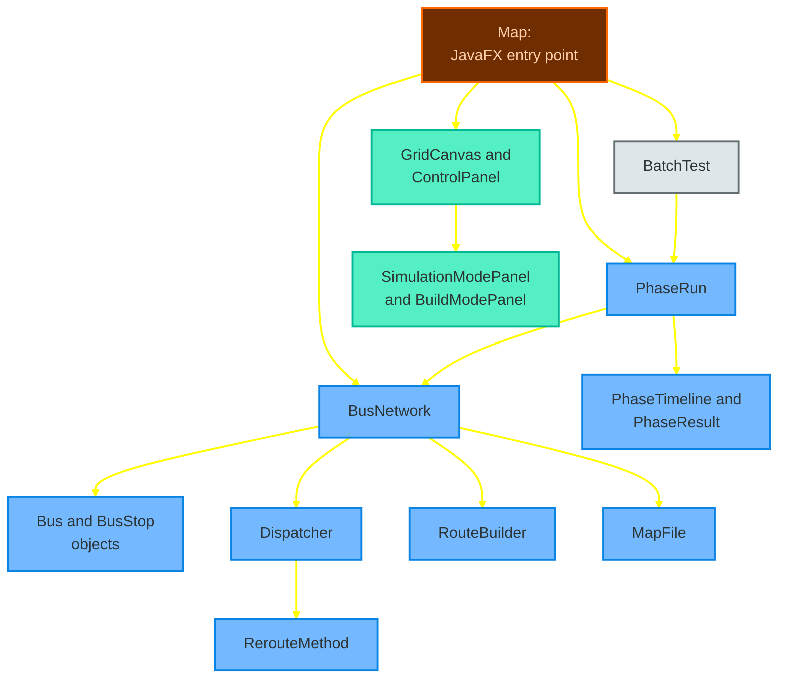

# Bus Rerouting — EE364 Final Project

A Java and JavaFX desktop simulator for comparing fixed-route public transportation with dynamic bus rerouting. The project evaluates the trade-off between passenger service quality and operating cost on a configurable urban grid. The application entry point is `Map` in `src/Map.java` (default Java package).

The repository is also reachable from **Help ▸ GitHub page…** in the application.

## What it does

A city is a 20 × 20 grid of streets, **1 km between streets, so the map is 20 km across** (a scale bar is drawn under the map; see `Scale`). Bus stops sit on grid intersections and passengers keep arriving at them, between 2 and 6 an hour at each stop.
Three buses drive fixed routes. The program compares three ways of running the same city:

| Phase | What the buses do |
|---|---|
| **Phase 1 – fixed cycle** | Every bus drives its own route over and over. |
| **Phase 2 – service-first** | Same start, but when a stop's passengers have waited longer than the *acceptable passenger wait*, the `Dispatcher` may send a nearby bus to it. It looks after the people who wait longest. |
| **Phase 2 – cost-saving** | Same start, but a bus with nobody on board waits until at least 5 people are waiting at its next stop instead of driving there, and a bus is only sent off its route to a big crowd. It looks after distance and cost per passenger, and pays for it with longer waits. |

The two Phase 2 methods share one scoring step but differ in its weights, in which stops they consider, in whether they count only the passengers that fit on the bus, and in whether an empty bus waits for passengers (all of this is in `RerouteMethod`).
Every phase starts from exactly the same state, so the results can be compared fairly: average passenger
wait (over every passenger who has boarded or is still waiting), **satisfaction**, distance driven (km), **driving cost**, cost per passenger and passengers served. Cost is the kilometres each bus drove times its cost per km, so a Double Decker costs more to drive than a Mini Bus. A result never depends
on the speed you watch at or on your computer's frame rate, because time advances in fixed steps.

### Satisfaction
Every passenger rates their wait from 0 to 5 stars in steps of half a star: 5 stars up to the **acceptable
passenger wait** (15 min by default), then falling evenly to 0 stars at 4 times that (60 min). Passengers
still waiting when the run ends are rated by their wait so far, because passengers in this simulation wait
until a bus picks them up. Average wait looks at the whole system; satisfaction also shows each stop on its
own (see the *Stops* tab), so a neglected stop cannot hide behind a busy one.

### Stops
* **High priority** – busy all day. The only kind a Double Decker may serve.
* **Low priority** – busy at the start and end of the day, quiet in the middle (arrival rate falls from minute 60 to 120, stays low until 180, recovers by 240).

### Buses
| Bus | Capacity | Speed | Cost per km | Notes |
|---|---|---|---|---|
| Standard Bus (`S`) | 30 | 30 km/h | 4.0 ⃁ | Can be rerouted |
| Mini Bus (`M`) | 15 | 42 km/h | 2.5 ⃁ | Can be rerouted |
| Double Decker (`DD`) | 50 | 18 km/h | 6.0 ⃁ | High-priority stops only; never rerouted |

At every stop a bus lets everyone off, then boards as many waiting passengers as fit. Stopping takes 1 minute.

### Simulation assumptions and scope

This is a simplified experimental model, not a prediction of a real transit network. Buses follow Manhattan paths (horizontal movement followed by vertical movement); traffic, congestion, passenger destinations, fuel price variation and road closures are not modelled. Every passenger alights at the next serviced stop. Passenger arrivals use a fractional accumulator rather than a stochastic arrival process during a run. The random seed controls network generation. The configured rates and costs are modelling assumptions, not measured operational data.

### How the Dispatcher decides (Phase 2)
Every stop that is worth considering is paired with every eligible bus and each pair gets a score.

The best positive score wins. For service-first a stop is only considered once it is overdue and the score is `minutes overdue + 0.5 × passengers waiting − 1.0 × grid distance`. For cost-saving a stop needs at least 8 people waiting and the score is `passengers the bus could pick up − 0.5 × grid distance`. A bus is eligible if it can be rerouted, is not already on a reroute, is not full, may serve that stop, is at most 12 cells away, and its own next scheduled stop has at most 4 people waiting. Stops already targeted by another bus are excluded. After a reroute the bus returns to the stop it was originally heading for. 

## Getting started

### Requirements

- A JDK compatible with your JavaFX SDK. The bundled JavaFX 27.0.1 JARs use class-file version 69, requiring at least Java 25 to read them; use a JDK supported by that SDK distribution.
- JavaFX SDK with the `javafx.controls` module (and its transitive dependencies).
- A graphical desktop environment. The bundled SDK contains Windows native libraries; on Linux or macOS, use an SDK built for your operating system and CPU architecture.
- A terminal or an IDE such as Visual Studio Code or IntelliJ IDEA. No Maven or Gradle build is required.

### Compile and run (Windows PowerShell)

Open a terminal in the project root, where `src/` and `assets/` are located:

```powershell
$fx = "$PWD/javafx-sdk-27.0.1/lib"
New-Item -ItemType Directory -Force out | Out-Null
javac -encoding UTF-8 --module-path "$fx" --add-modules javafx.controls -d out src/*.java
java --module-path "$fx" --add-modules javafx.controls -cp out Map
```

### Compile and run (Linux/macOS)

Install a compatible platform-specific JavaFX SDK first, then substitute its actual library path:

```bash
FX=/path/to/javafx-sdk/lib
mkdir -p out
javac -encoding UTF-8 --module-path "$FX" --add-modules javafx.controls -d out src/*.java
java --module-path "$FX" --add-modules javafx.controls -cp out Map
```

### Run from an IDE

Set `src` as the source directory, add the JavaFX libraries, select `Map` as the main class and configure the VM arguments:

```text
--module-path "<absolute-path-to-javafx-sdk>/lib" --add-modules javafx.controls
```

The supplied `.vscode/settings.json` and `.vscode/launch.json` contain machine-specific absolute paths; replace them with your local SDK path before launching. Set the working directory to the project root.

The application searches for `StandardBusIcon.png`, `MiniBusIcon.png` and `DoubleDeckerIcon.png` in `assets/`, then elsewhere below the project folder. Missing icons fall back to coloured squares.

### Troubleshooting

| Problem | Suggested fix |
|---|---|
| `package javafx... does not exist` | Check the SDK library path and module arguments. |
| Unsupported class-file version | Use a compatible newer JDK or a compatible JavaFX distribution. |
| Could not find or load main class | Compile with `-d out` and run `-cp out Map`, not `com.busalloc.Map`. |
| Native library or graphics startup error | Use a JavaFX SDK matching the OS and architecture and launch in a graphical session. |
| IDE cannot resolve JavaFX | Replace the machine-specific paths in `.vscode/`. |

## Using it

The window has the map on the left and a side bar on the right (drag the divider to resize it).

**Top of the side bar:** the *Switch to Build Mode* button, then the phase buttons (*Fixed cycle* under "Phase 1"; *Service-first* and *Cost-saving* under "Phase 2: rerouting"), *Pause*, and a bar showing how far the run has got.

**Simulation Mode tabs**
* **Results** – a table with a column per phase (a running phase shows its figures so far), how much better or worse each rerouting method is than Phase 1 (green / red, live while it runs), and a chart of wait, satisfaction or distance driven over time.
* **Stops** – one row per stop: average stars, share of happy passengers (4 stars or more), average wait (of the same passengers the stars are given to) and people waiting now.
* **Settings** – the map's seed, number of stops (3–60), *New random map*, acceptable passenger wait (1–120 min), simulation duration (30–1440 min), speed (0.5×, 1×, 2×, 5×, 10×, 20×, 30×) and the *batch test*.
* **Buses & Log** – what every bus is doing, and the event log. Lines are coloured by kind (reroutes orange, phase start/finish blue, edits green, problems red, batch results purple, ordinary arrivals grey); the colours are constants in `LogKind`.

**Build Mode** – edit the map by hand. Tools are grouped into *Stops* (add, change priority, delete) and *Buses* (add, edit route, delete). A chosen tool stays highlighted and active until you press it again or press `Esc`; a hint box says what the next click does. *Finish bus* turns green once a route has two stops, and *Cancel* turns red while a route is being picked. *This map* lists the stops and every bus route. Any edit resets the run, because old results no longer match the map. Right-click a stop (in either mode) to add 10 waiting passengers.

**File menu** – save a build to a `.busmap` file, load one, copy it as text to the clipboard, or paste a build from the clipboard (handy for sending a map to a teammate in a message).

### Keyboard shortcuts
| Key | Action |
|---|---|
| `Space` | Pause / resume |
| `1` / `2` / `3` | Run Phase 1 / Phase 2 service-first / Phase 2 cost-saving |
| `N` | New random map |
| `Ctrl+B` | Switch between Simulation and Build Mode |
| `Esc` | Cancel the active build tool |
| `Ctrl+S` / `Ctrl+O` | Save / load a build file |
| `Ctrl+C` / `Ctrl+V` | Copy / paste a build (normal copy/paste while typing in a text box) |

### Seeds
The same seed (and number of stops) always produces the same stops, crowds, arrival rates, routes and bus colours. The seed is shown in *Settings*; type one in and press *Use seed* to bring a map back.

### Batch test
*Run batch test* builds 20 random maps (consecutive seeds starting from a random one, written to the log so a result can be traced), runs all three phases on each without drawing, and reports for both rerouting methods how much they improved on Phase 1 (wait, satisfaction in stars, distance driven, driving cost, cost per passenger) and on how many maps they were better. It uses its own networks, so the map and run on screen are untouched.

### The `.busmap` format
Plain text, one item per line:
```
BUSMAP 1
stop,<x>,<y>,<HIGH|LOW>,<arrival rate>,<starting crowd>
bus,<STANDARD|MINI|DOUBLE>,<#rrggbb>,<stop numbers of the route, space separated>
```
Coordinates range from 0 to 20 inclusive; route references are one-based stop numbers in file order. The arrival rate field stores passengers per simulation-clock second (six simulated minutes at 1×), not passengers per hour. A route must have at least two stops; Double Decker routes may reference only high-priority stops.

Example:

```text
BUSMAP 1
stop,2,3,HIGH,0.4,8
stop,8,3,HIGH,0.5,10
stop,8,9,LOW,0.2,4
bus,STANDARD,#1e90ff,1 3
bus,DOUBLE,#cc4c29,1 2
```

A file is checked completely before anything is replaced; if a line is wrong the current map is left alone and the message names the line to fix.

## How the code is organised

| Group | Classes | Job |
|---|---|---|
| **Things on the map** | `MapItem` → `Vehicle` → `Bus` → `StandardBus`, `MiniBus`, `DoubleDecker`; `MapItem` → `BusStop` → `HighPriorityStop`, `LowPriorityStop`; `Location`, `Icon`, `Reroutable` | Each thing knows its own data, name, colours, picture and how to draw itself. |
| **The simulation** | `BusNetwork`, `PhaseRun`, `Dispatcher`, `RerouteMethod`, `StopSatisfaction`, `PhaseResult`, `PhaseTimeline`, `BatchTest`, `RouteBuilder` | No screen code. `BusNetwork` holds the stops and buses, moves them, applies every edit and adds up the totals; `PhaseRun` is one run of one phase (clock, fixed steps, chart samples, result); `Dispatcher` picks reroutes using the weights of a `RerouteMethod`; `StopSatisfaction` holds the star rating rule and one stop's figures; `BatchTest` repeats it on many random maps. |
| **Saving and sharing** | `MapFile`, `MapFileException`, `BuildSharing` | The `.busmap` format; file dialogs and clipboard. |
| **The screen** | `Map` (starts the program), `GridCanvas`, `ControlPanel`, `BuildModePanel`, `AppMenuBar`, `GitHubDialog`, `KeyboardShortcuts`, `ResultsChart`, `LogKind` | Windows, panels, drawing and input. They show the model and pass button presses to it; they never change the rules. |
| **Simulation Mode panel** | `SimulationModePanel` (puts the parts together and refreshes only the tab that is showing), `PhaseBar`, `ResultsTab`, `StopsTab`, `SettingsTab`, `BusesAndLogTab` | One class per part of the side bar. Each takes only what it needs: the phase bar gets `startPhase` and `setPaused`, *Settings* gets `newRandomMap`, `useSeed` and `runBatchTest`. |
| **Constants** | `Scale`, `Palette` | `Scale` holds the real-world units (km per cell, minutes per simulated second, dwell time, arrivals per hour, the currency sign); `Palette` holds every colour of the map and the side panels. Change a value there and it changes everywhere. |

Design choices worth knowing:
* **Polymorphism instead of `if`/`instanceof` chains** – a bus knows its own type name, a stop knows its own colours.
* **`Icon` is a field of `Bus` and `BusStop`.** It finds the picture file, loads each file only once for the whole program, tints a copy for a bus, and hands out a copy shrunk to the size drawn. A stop could be given a picture with one constructor argument.
* **`Reroutable` is an interface**, so only buses that can be rerouted need the method.
* **Build Mode and loading a file use `BusNetwork`'s edit methods**, so the rules for numbering, priority swaps and bus replacement live in one place.


## Repository structure

```text
EE364project/
├── src/                         # Java source files (default package)
├── assets/                      # Three bus icon PNGs
├── Map Seeds for Testing/       # Six saved .busmap scenarios
├── Project Details/             # Assignment and grading rubric
│   ├── Project Assignment/
│   └── Project Rubric/
├── Project Proposal/            # Final project proposal PDF
├── UML/
│   ├── Initial UML/             # Editable Draw.io diagram and PNG
│   └── Final UML/               # PNG
├── javafx-sdk-27.0.1/            # Bundled Windows JavaFX SDK
├── .vscode/                     # IDE configuration (local paths)
├── .gitignore
└── README.md
```

## Architecture and execution flow



`Map` connects the interface to the model and advances the active run through a JavaFX animation timer. `PhaseRun` restores the network at startup, advances it in fixed 0.05-second clock steps (0.3 simulated minutes), records timeline samples and invokes rerouting when enabled. `BusNetwork` updates passenger arrivals, vehicle movement, stop service and metrics. `Dispatcher` evaluates candidate stop/bus pairs; its search is a nested scan with worst-case O(S × B × S) time per decision for S stops and B buses, because eligibility can scan the stops again. It is a greedy heuristic, not a global route optimiser.

## Default configuration

| Parameter | Default / range |
|---|---|
| Grid | 20 × 20 cells; 21 × 21 intersections |
| Generated stops | 7 (3–60 in Settings) |
| Generated fleet | 3 buses |
| Initial crowd | 3–12 passengers per generated stop |
| Base arrival rate | 2–6 passengers/hour per generated stop |
| Acceptable wait | 15 minutes (1–120) |
| Run duration | 300 minutes (30–1440) |
| Clock speed | 1×; six simulated minutes per real second |
| Stop dwell | 1 simulated minute |
| Batch size | 20 generated networks |

## Evaluation metrics

| Metric | Calculation / interpretation |
|---|---|
| Average wait | Mean wait across boarded passengers and passengers still waiting at the measurement time. Lower is better. |
| Satisfaction | Mean of individual ratings from 0 to 5 stars, rounded per passenger to the nearest half star. Higher is better. |
| Happy passengers | Share of rated passengers with at least 4 stars, shown per stop. |
| Distance driven | Sum of distance travelled by all buses in kilometres. |
| Driving cost | Sum of each bus's distance multiplied by its cost per kilometre. |
| Cost per passenger | Total driving cost divided by total boardings; undefined when nobody boards. |
| Passengers served | Total number of boardings. |

For wait, distance and cost measures, percentage improvement is `(baseline - rerouting) / baseline × 100`. Satisfaction improvement is the difference in stars. A positive improvement is favourable. A zero baseline or undefined metric is not a valid percentage comparison.

## Testing and reproducibility

The archive contains saved test scenarios and an integrated batch-testing feature; it does not contain a standalone automated unit-test suite. The following are recommended manual acceptance checks, not claims of executed test results.

1. Launch the application and confirm that the default map and three buses appear.
2. Load a supplied `.busmap` from `Map Seeds for Testing/` using the File menu.
3. Set the acceptable wait and duration, then run Fixed cycle, Service-first and Cost-saving separately to completion without modifying the map or injecting passengers.
4. Compare the Results and Stops tabs. Record the seed or save the map along with the settings.
5. Repeat a phase at a different playback speed and compare completed metrics.
6. Run the batch test and check that its starting seed and aggregate comparisons appear in the log, without replacing the displayed network.
7. In Build Mode, add, edit and remove stops and routes; verify that invalid Double Decker routes are rejected.
8. Save a map, reload it and verify the stop locations, priorities, crowds, rates, bus colours and routes. Try loading a malformed file and confirm that the existing map remains intact.

Supplied test maps:

- `BasedBus.busmap`
- `DrivenKmMap.busmap`
- `ILikethisMap.busmap`
- `LargeBusstopsCostsavingDoesntdoanything.busmap`
- `LuckySeed.busmap`
- `This a good test.busmap`

Rerouting is not guaranteed to improve every metric or every map. A useful evaluation reports the trade-offs rather than assuming one method always wins.

## Course documentation

- [Project assignment](Project%20Details/Project%20Assignment/EE364_Final_Project_Assignment.pdf)
- [Final project rubric](Project%20Details/Project%20Rubric/Final%20Project%20Rubric%20V2.pdf)
- [Project proposal](Project%20Proposal/EE364_Final_Project_Proposal_Form_FINAL.pdf)
- [Initial UML diagram](UML/Initial%20UML/Initial%20UML.png)
- [Final UML diagram](UML/Final%20UML/Final%20UML.png)

## Authors

Developed for the EE364 final project by Ahmad Balfakeeh, Abdullah Balubaid, Salam Kanno and Omar AbuSabaah.

## Disclaimer
No project-level license file is present in the supplied archive. The bundled JavaFX distribution includes its own legal notices.
